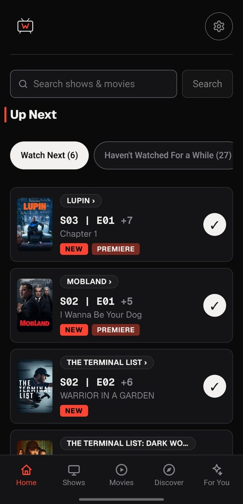
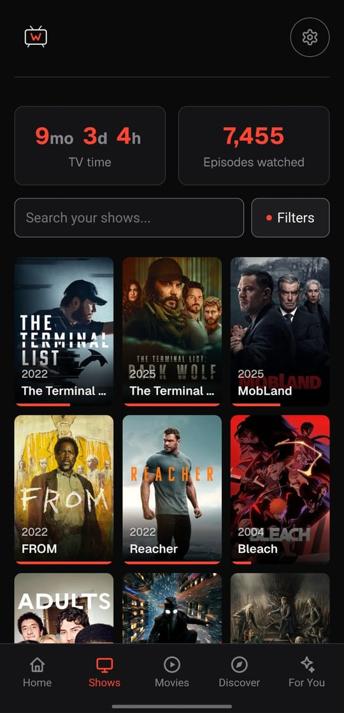
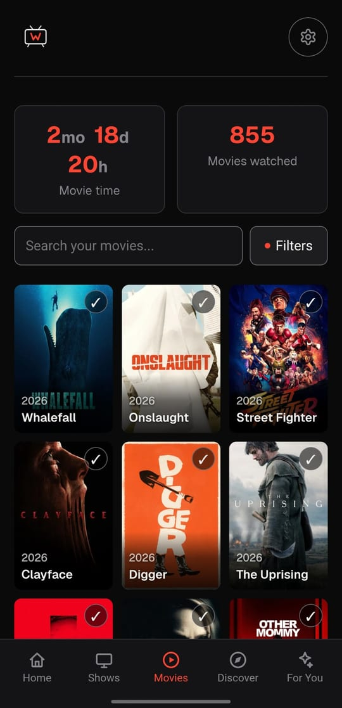
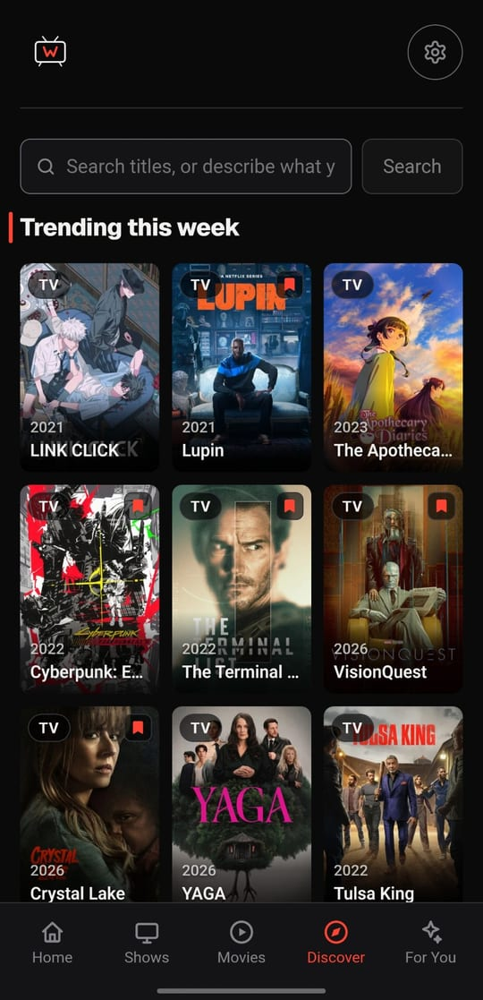
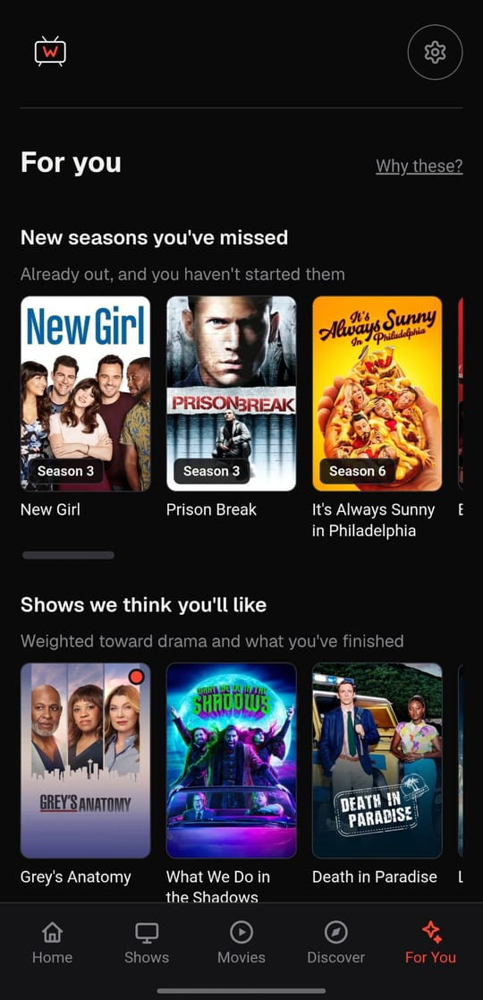
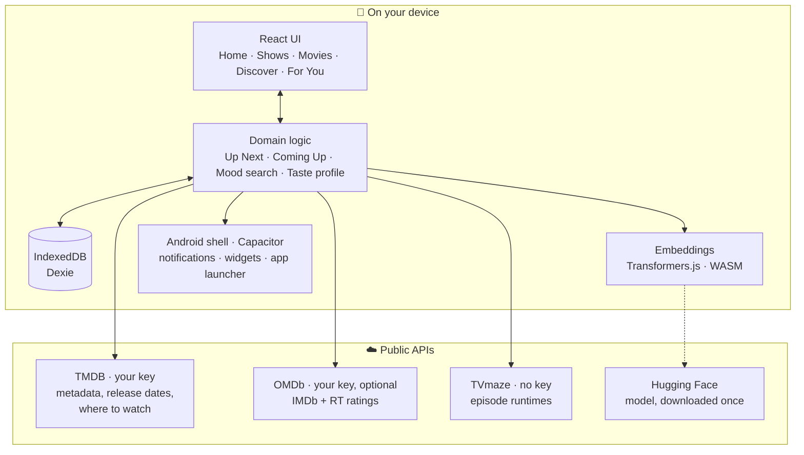
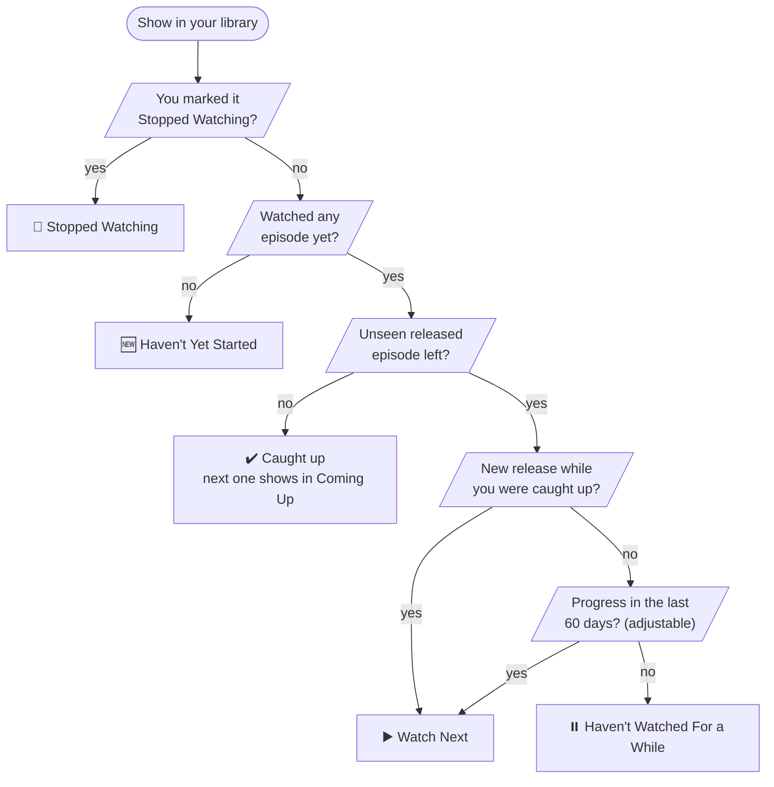
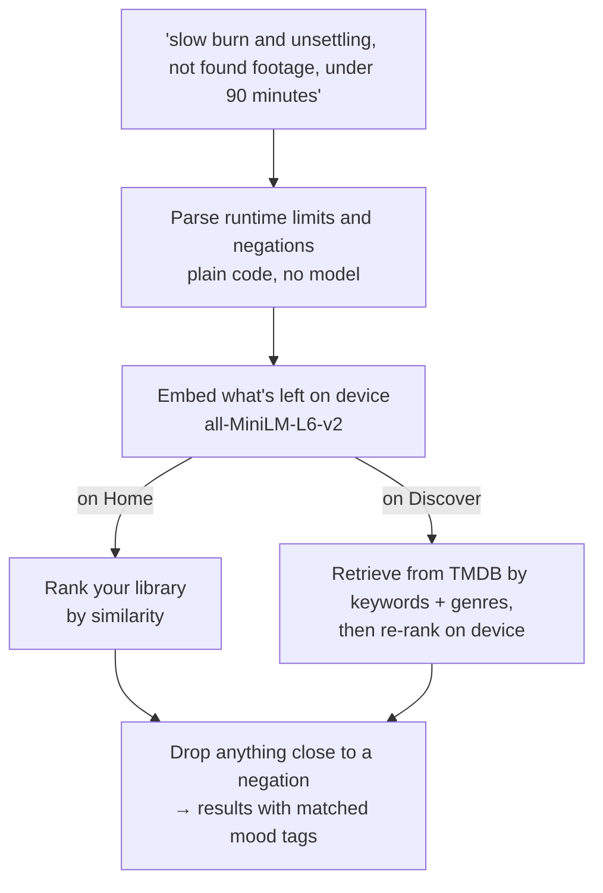
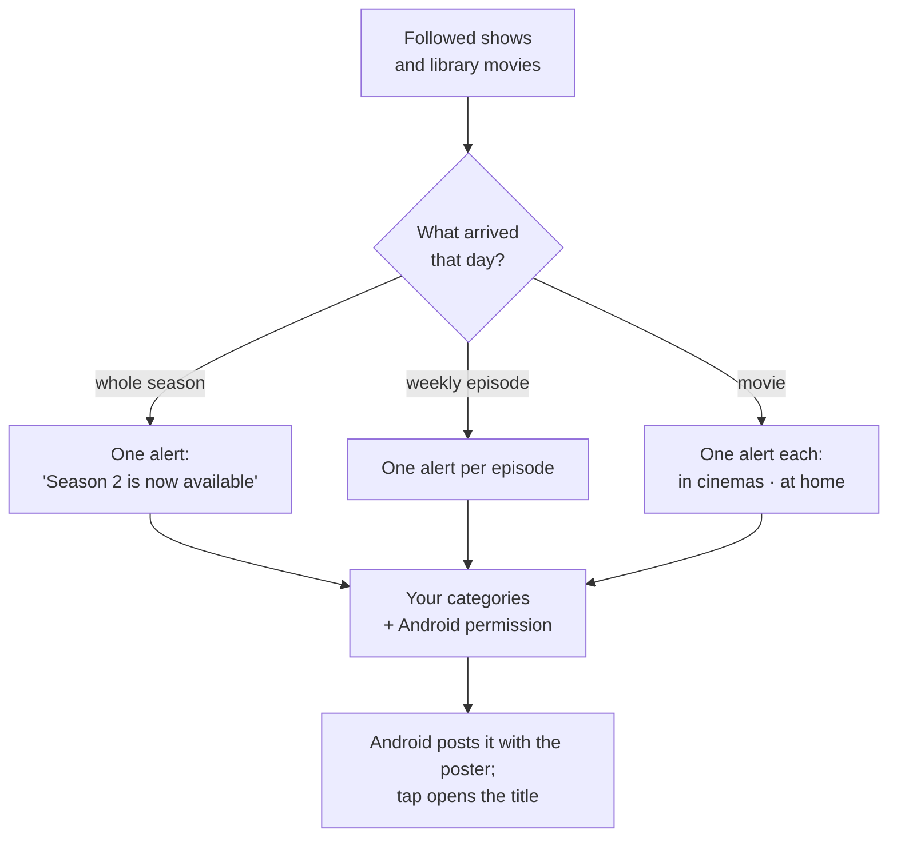

<div align="center">


# WatchTime

**A local-first TV and movie tracker.**<br/>
Know what to watch next, what's coming up, and keep your whole library on your own device.


[Features](#features) · [How it works](#how-it-works) · [Getting started](#getting-started) · [Project structure](#project-structure) · [Privacy](#privacy) · [Copyright](#copyright)

</div>

<br/>

<table align="center">
  <tr>
    <td align="center"></td>
    <td align="center"></td>
    <td align="center"></td>
    <td align="center"></td>
    <td align="center"></td>
  </tr>
  <tr>
    <td align="center"><sub><b>Home</b><br/>Up Next</sub></td>
    <td align="center"><sub><b>Shows</b><br/>Library &amp; progress</sub></td>
    <td align="center"><sub><b>Movies</b><br/>Watched &amp; watchlist</sub></td>
    <td align="center"><sub><b>Discover</b><br/>Trending &amp; search</sub></td>
    <td align="center"><sub><b>For You</b><br/>Taste-based picks</sub></td>
  </tr>
</table>

## About

WatchTime started as a replacement for TV Time, which shut down in July 2026. It tracks episodes and movies, works out what you should watch next, and tells you when something in your library comes out.

There is no server and no account. Your library lives in the device's IndexedDB, and the app talks directly to TMDB, OMDb and TVmaze using your own free API keys. It runs as a web app and, through Capacitor, as a native Android app with notifications and home-screen widgets.

## Features

| | Feature | Android | Web |
|---|---|:---:|:---:|
| 📺 | **Up Next**: Watch Next, Haven't Watched For a While, Haven't Yet Started and Stopped Watching, worked out from your real watch history | ✅ | ✅ |
| 🗓️ | **Coming Up**: upcoming episodes for shows you follow, and watchlist movies releasing this month tagged *In Theaters* or *Digital Release* | ✅ | ✅ |
| 🎬 | **Movies**: watched list, watchlist and rewatch counts | ✅ | ✅ |
| 🔎 | **Mood search**: describe what you feel like watching in plain English; runs on-device | ✅ | ✅ |
| ✨ | **For You**: recommendations from a taste profile of your genres, completion rate, rewatches and language | ✅ | ✅ |
| 🧭 | **Discover**: trending, upcoming and newly-at-home titles, with one search box for titles or moods | ✅ | ✅ |
| 📡 | **Where to watch**: streaming providers for your region; tapping one opens the title in that service's app or site | ✅ | ✅ |
| ⭐ | **Ratings**: IMDb everywhere, Rotten Tomatoes for movies | ✅ | ✅ |
| 📊 | **Stats**: total TV and movie time, episodes and movies watched | ✅ | ✅ |
| 🔔 | **Release notifications**: new episodes, whole-season drops, theatrical and digital movie releases, with the poster | ✅ | — |
| 🧩 | **Home-screen widgets**: Up Next and Coming Up, marking episodes watched from the widget | ✅ | — |
| 📥 | **TV Time import**: JSON or GDPR CSV export, with title matching you can confirm | ✅ | ✅ |
| 💾 | **Backup & restore**: the whole library in one file | ✅ | ✅ |

## How it works

### Architecture

Everything runs on the device. The only outbound traffic is the app calling public APIs with your keys, plus a one-time model download for mood search.



### Up Next

Every show in the library lands in exactly one place, decided from watch history and release dates rather than an imported status flag. Rewatching old episodes never counts as progress, and a new season brings back a show you were caught up on, but not one you had abandoned midway.



### Mood search

Runtime limits and negations are parsed deterministically, so the model only ever embeds what you want included. On Home it ranks your own library; on Discover it first retrieves candidates from TMDB, then re-ranks them on the device.



### Release notifications

Local notifications, not push. The schedule is rebuilt from the library on launch, on resume and after each sync, so it always matches what you follow.



## Tech stack

| Layer | Tools |
|---|---|
| App | React 19, TypeScript, Vite |
| Storage | Dexie.js over IndexedDB |
| Native | Capacitor 8; Java plugins for notifications, widgets and the streaming launcher |
| On-device ML | Transformers.js, `all-MiniLM-L6-v2` (int8, ~25 MB), ONNX Runtime WASM |
| Data | TMDB (metadata, release dates, where to watch via JustWatch), OMDb (ratings), TVmaze (runtimes) |
| Tooling | oxlint, tsx scenario checks |

## Getting started

**You need:** Node 20+ and a free [TMDB API key](https://www.themoviedb.org/settings/api). An [OMDb key](https://www.omdbapi.com/apikey.aspx) is optional and adds IMDb and Rotten Tomatoes ratings. TVmaze needs no key.

```bash
git clone https://github.com/AtharvaK14/WatchTime.git
cd WatchTime
npm install
npm run dev
```

Open the URL Vite prints. A short first-run wizard asks for the keys, which are stored only on your device.

### Android

Requires Android Studio and JDK 21. The app targets Android 16 (API 36) and runs on Android 7.0 (API 24) and up.

```bash
npm run cap:sync   # build the web app and copy it into android/
npm run cap:open   # open the project in Android Studio
```

### Scripts

| Script | What it does |
|---|---|
| `npm run dev` | Start the dev server |
| `npm run build` | Type-check and build to `dist/` |
| `npm run lint` | Lint with oxlint |
| `npm run check:watch-next` | Scenario checks for the Up Next categories |
| `npm run check:coming-up` | Scenario checks for Coming Up and release tags |
| `npm run check:notifications` | Scenario checks for release detection, using TMDB data |
| `npm run check:streaming` | Provider-name normalisation checks |
| `npm run build:mood-vocabulary` | Rebuild the precomputed mood-tag embeddings |
| `npm run cap:sync` / `cap:open` | Sync and open the Android project |

## Project structure

```
src/
├── pages/            Home, Shows (Library), Movies, Discover (AddTitle), For You, Settings, Diagnostics
├── components/       Details panels, search, onboarding, notification settings, poster cards
├── lib/
│   ├── watchNext.ts      Up Next categories
│   ├── comingUp.ts       Upcoming episodes and Releasing this month
│   ├── releaseState.ts   What "newly available" means, shared by lists and notifications
│   ├── episodeSync.ts    Episode cache and refresh rules
│   ├── moodSearch/       Parsing, embeddings, library index, TMDB discovery
│   ├── recommend/        Watch signals, taste profile, For You sections
│   ├── notifications/    Release events, scheduling, permissions
│   ├── streaming/        Where-to-watch providers and app launching
│   └── widget/           Snapshot and sync for the Android widgets
├── importer/         TV Time JSON and CSV import
├── db.ts             Dexie schema, the single source of truth
└── tmdb.ts · omdb.ts · tvmaze.ts   API clients
android/              Capacitor project, plus native notify/, widget/ and stream/ plugins
scripts/              Scenario checks and build helpers
docs/                 Privacy policy and README screenshots
```

## Privacy

WatchTime collects nothing. Your library, watch history and API keys stay on your device. Network requests go straight from the device to TMDB, OMDb and TVmaze using your own keys, plus a one-time model download from the Hugging Face Hub if you use mood search; that request carries nothing about you. No accounts, analytics or ads. Full policy: [`docs/privacy.html`](docs/privacy.html).

## Acknowledgements

- Metadata, images and release dates from [TMDB](https://www.themoviedb.org/). *This product uses the TMDB API but is not endorsed or certified by TMDB.*
- Streaming availability from [JustWatch](https://www.justwatch.com/), via TMDB.
- Ratings from [OMDb](https://www.omdbapi.com/) and episode runtimes from [TVmaze](https://www.tvmaze.com/).
- On-device embeddings with [Transformers.js](https://github.com/huggingface/transformers.js) and [`all-MiniLM-L6-v2`](https://huggingface.co/sentence-transformers/all-MiniLM-L6-v2).

## Copyright

Copyright © 2026 Atharva Kadam. All rights reserved.

The source is public so you can read it and build it for your own personal use. No other rights are granted: you may not distribute, publish, or sell it, or any app built from it, in whole or in part, on an app store or anywhere else, without written permission. The WatchTime name and logo may not be used for other apps.
